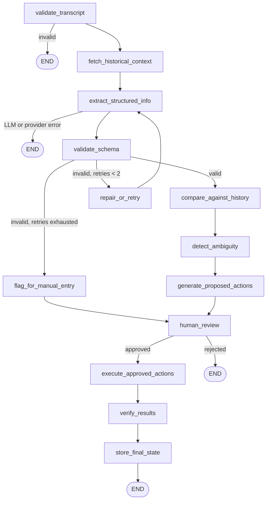

# Meeting-to-Execution Copilot (M2E)

A backend service that takes a pasted meeting transcript, extracts decisions, action items, and open questions with Gemini, pauses for a human to review them, and then creates the approved action items as Jira tickets.

> **Status:** The backend and Jira integration are built and have been run end-to-end against a real PostgreSQL database and a real Jira Cloud site. There is no frontend yet. See [Known limitations](#known-limitations).

---

## What It Does

1. **Submit Transcript:** You submit a transcript to a project (`POST /api/meetings`). The API stores it and responds immediately.
2. **Background Workflow:** A LangGraph workflow runs in the background. It validates the transcript, loads open questions and decisions from earlier meetings in the same project, extracts structured data with Gemini, and checks whether any new decision answers an old open question.
3. **Ambiguity Detection:** Vague items are flagged (missing owner, vague deadline, low confidence). Only action items with confidence of 0.7 or higher become proposed tickets, capped at 10 per run.
4. **Human Review (HITL):** The workflow pauses for human review, with its state checkpointed in PostgreSQL.
5. **Jira Ticket Creation:** On approval (optionally with edited actions), it creates the Jira tickets. On rejection, nothing is sent to Jira.
6. **Cross-Meeting State:** After execution, decisions, action items, and open questions are saved, and old open questions that were answered are marked resolved.
7. **Zero-Side-Effect Guarantee:** Nothing reaches Jira without an explicit approval call.

---

## Sample Run

Run on a transcript where nothing was actually agreed, and several commitments were hedged (*"Ravi said he'll probably take care of the backend changes but wasn't sure if he can finish them this week"*):

| Proposed Action | Owner | Deadline | Confidence |
| :--- | :--- | :--- | :--- |
| Take care of the backend changes | Ravi | this week | 0.8 |
| Check the authentication logs and see what is happening | Priya | none | 1.0 |
| Update the dashboard filters | Unassigned | none | 0.7 |
| Talk to the external team regarding payment API credentials | Ravi | tomorrow | 1.0 |

The run extracted 0 decisions and 2 open questions, produced ambiguity flags (for example missing owner and deadline on the dashboard-filters item), and after approval created 4 Jira tickets.

---

## How It Works



| Node | What It Does |
| :--- | :--- |
| `validate_transcript` | Rejects empty transcripts and transcripts under 50 characters. |
| `fetch_historical_context` | Loads open questions and active decisions for the project. |
| `extract_structured_info` | Gemini call that returns decisions, action items, and open questions as JSON. |
| `validate_schema` | Zod check of the draft extraction. |
| `repair_or_retry` | Increments the retry count and appends a repair note to the transcript. Maximum 2 retries. |
| `flag_for_manual_entry` | Reached when retries are exhausted. Sets a flag and an error. |
| `compare_against_history` | Second Gemini call: does a new decision answer a previously open question? Returned IDs not in the real open-question set are discarded. |
| `detect_ambiguity` | Merges the LLM's own per-item flags with rule checks: confidence below 0.7, missing owner, missing deadline. |
| `generate_proposed_actions` | Keeps action items with confidence of at least 0.7, caps at 10, and stores them in `proposed_actions` as pending. |
| `human_review` | Calls LangGraph `interrupt()`. The graph stays paused until resumed with `Command({ resume })`. |
| `execute_approved_actions` | Decrypts the workspace's Jira credentials and creates tickets, using an idempotency key per action. |
| `verify_results` | Checks that every execution result is a success with a ticket key. |
| `store_final_state` | Writes decisions, action items, and open questions, marks resolved questions, and updates `workflow_runs`. |

> **Note:** Gemini is used in two places only: `extract_structured_info` and `compare_against_history`. Every routing decision is plain TypeScript reading the workflow state.

---

## Run Statuses

| Status | Set When |
| :--- | :--- |
| `processing` | The run is created by `POST /api/meetings`. |
| `pending_review` | The graph paused at `human_review` with no error. |
| `executing` | `POST /approve` flips the status from `pending_review`. |
| `completed` | The resumed graph finished with no error. |
| `rejected` | `POST /reject` was called. |
| `failed` | An error is set in the workflow state, or an exception was thrown. |

---

## Tech Stack

| Layer | Choice |
| :--- | :--- |
| **Runtime** | Node.js, TypeScript, Express |
| **Database** | PostgreSQL, plain SQL through `pg` (no ORM) |
| **Workflow** | LangGraph.js with `@langchain/langgraph-checkpoint-postgres` |
| **LLM** | Google Gemini (`@google/genai`), structured JSON output via `responseSchema`, temperature 0 |
| **Validation** | Zod |
| **Auth** | JWT (`jsonwebtoken`), passwords hashed with `bcryptjs` (cost 12) |
| **Encryption** | AES-256-GCM using Node's built-in `crypto` |
| **External System** | Jira Cloud REST API v3 |

> Model names are configured in `src/extraction/llm.ts` and `src/extraction/resolver.ts`.

---

## API Reference

All responses are JSON. Errors have the shape `{ "error": "..." }`. Every route except register and login requires `Authorization: Bearer <token>`.

| Method | Path | Auth | Purpose |
| :--- | :--- | :--- | :--- |
| `POST` | `/api/auth/register` | No | Body: `email`, `password` (8+ characters), optional `full_name`. Returns a token and the user. |
| `POST` | `/api/auth/login` | No | Body: `email`, `password`. Returns a token and the user. |
| `POST` | `/api/projects` | Yes | Body: `name`, optional `description`, `jira_project_key`. Uses the caller's workspace, creating "My Workspace" if none exists. |
| `GET` | `/api/projects/:id` | Yes | Returns one project created by the caller. |
| `POST` | `/api/integrations/jira/connect` | Yes | Body: `workspaceId`, `domain`, `email`, `apiToken`, optional `expiresAt`. Encrypts and stores credentials, replacing any existing Jira connection for that workspace. |
| `GET` | `/api/integrations/jira/status?workspaceId=` | Yes | Returns whether Jira is connected and whether the connection has expired. |
| `POST` | `/api/meetings` | Yes | Body: `project_id`, `transcript`. Returns 201 with `meeting_id`, `workflow_run_id`, `status: "processing"`. 409 if the same transcript was already submitted. |
| `GET` | `/api/workflow-runs/:id` | Yes | Poll a run. At `pending_review` it also returns extraction, proposed_actions, ambiguity_flags, resolved_questions. At `completed` it returns extraction and execution_results. Otherwise returns the run row. |
| `POST` | `/api/workflow-runs/:id/approve` | Yes | Optional body: `edited_actions`, which replaces proposed actions. 409 unless run is `pending_review`. |
| `POST` | `/api/workflow-runs/:id/reject` | Yes | Rejects the run. No Jira call is made. 409 unless run is `pending_review`. |
| `GET` | `/health` | No | Liveness check. |

> A resource that does not exist and a resource that belongs to someone else both return `404 Not Found`.

---

## Getting Started

### Prerequisites
* Node.js 18 or newer (the Jira client uses built-in `fetch`)
* PostgreSQL
* A Google Gemini API key
* A Jira Cloud site and an API token ([generate token here](https://id.atlassian.com/manage-profile/security/api-tokens))

### Install
```bash
cd backend
npm install
```

### Configure
Create `backend/.env`:
```env
# Database (defaults shown)
DB_HOST=localhost
DB_PORT=5432
DB_USER=postgres
DB_PASSWORD=your-password
DB_NAME=meeting_copilot

# Auth
JWT_SECRET=a-long-random-string
JWT_EXPIRES_IN=7d

# Encrypts stored Jira credentials. Must be 64 hex characters (32 bytes).
# Generate with: node -e "console.log(require('crypto').randomBytes(32).toString('hex'))"
ENCRYPTION_KEY=

# LLM
GEMINI_API_KEY=

# Server
PORT=3001
NODE_ENV=development

# The JIRA_* variables below are only used by the seed script and manual test scripts.
# In normal use, Jira credentials come from the database after POST /api/integrations/jira/connect.
JIRA_BASE_URL=https://your-site.atlassian.net
JIRA_EMAIL=you@example.com
JIRA_API_TOKEN=
JIRA_PROJECT_KEY=PROJ
```
> `JWT_SECRET`, `ENCRYPTION_KEY`, and `GEMINI_API_KEY` are required.

### Create Database
```bash
createdb meeting_copilot
psql -d meeting_copilot -f src/db/schema.sql
```
> The LangGraph checkpoint tables are created automatically when the server starts.

### Run
```bash
npx ts-node src/index.ts
```
The server listens on `PORT` (default 3001).

---

## Try It

```bash
# 1. Register. The response contains a token.
curl -s -X POST localhost:3001/api/auth/register \
  -H "Content-Type: application/json" \
  -d '{"email":"you@example.com","password":"at-least-8-chars","full_name":"You"}'

export TOKEN=<token from the response>

# 2. Create a project. This also creates your workspace.
curl -s -X POST localhost:3001/api/projects \
  -H "Authorization: Bearer $TOKEN" -H "Content-Type: application/json" \
  -d '{"name":"Demo","jira_project_key":"PROJ"}'

# 3. Find your workspace id
psql -d meeting_copilot -c "SELECT id FROM workspaces;"

# 4. Connect Jira. "domain" is the part before .atlassian.net.
curl -s -X POST localhost:3001/api/integrations/jira/connect \
  -H "Authorization: Bearer $TOKEN" -H "Content-Type: application/json" \
  -d '{"workspaceId":"<workspace id>","domain":"your-site","email":"you@example.com","apiToken":"<jira api token>"}'

# 5. Submit a transcript
curl -s -X POST localhost:3001/api/meetings \
  -H "Authorization: Bearer $TOKEN" -H "Content-Type: application/json" \
  -d '{"project_id":"<project id>","transcript":"Priya will check the authentication logs by Friday. ..."}'

# 6. Poll until status is pending_review, then read the proposed actions
curl -s localhost:3001/api/workflow-runs/<workflow_run_id> -H "Authorization: Bearer $TOKEN"

# 7. Approve. This creates the Jira tickets.
curl -s -X POST localhost:3001/api/workflow-runs/<workflow_run_id>/approve \
  -H "Authorization: Bearer $TOKEN"
```

---

## Scripts and Manual Tests

| Command | What It Does |
| :--- | :--- |
| `npx tsc --noEmit` | Type check. |
| `npm run seed:jira` | Encrypts the `JIRA_*` credentials from `.env` and stores them for a workspace. Takes workspace ID as argument or `SEED_WORKSPACE_ID`. Refuses to run when `NODE_ENV=production` unless `ALLOW_SEED=true`. |
| `npx ts-node src/test-extraction.ts` | Calls Gemini on a sample transcript and asserts that decisions, action items, and open questions are all non-empty. |
| `npx ts-node src/test-jira.ts` | Creates real tickets in `JIRA_PROJECT_KEY` and checks them. Duplicate detection here uses an in-memory set. |
| `npx ts-node src/test-execution-node.ts` | Runs the execute node twice against real Postgres and Jira to show that the second run is skipped by the idempotency check. |
| `npx ts-node src/test-workflow.ts` | Runs the whole graph and auto-approves it. Reads `backend/sample_transcript.txt`. |
| `npx ts-node src/test-mcp-tool.ts` | Calls the MCP tool handlers against live Jira, including a missing-argument case and a nonexistent issue key. |

---

## Design Notes

* **A workflow, not an autonomous agent:** The steps are known in advance and the end result creates real tickets, so control flow lives in code. LangGraph is used for conditional routing, the bounded retry loop, and a durable pause for human approval.
* **Human approval before any side effect:** Gemini output never triggers a Jira call. The only path to `execute_approved_actions` is an authenticated approve request.
* **Duplicate protection:**
  * **Transcripts:** SHA-256 of trimmed text, with a `UNIQUE (project_id, transcript_hash)` constraint. A repeat returns 409.
  * **Approvals:** `UPDATE workflow_runs SET status = 'executing' WHERE id = $1 AND status = 'pending_review'`. If no row changes, the request gets 409.
  * **Tickets:** An idempotency key is the SHA-256 of workflow run ID, action type, and a sorted payload (summary, owner, deadline, project key). The execute node looks the key up in `execution_logs` before calling Jira, and `execution_logs.idempotency_key` has a unique index.
* **Credential storage:** Jira credentials are encrypted with AES-256-GCM, with a fresh random 12-byte IV per record, and stored as `iv:authTag:ciphertext` in `integration_connections.encrypted_token`. Decryption throws if data was altered. Credentials are never returned by the API.
* **Authorization:** The JWT identifies the caller. Each route checks that the project, workspace, or run belongs to that caller through `workspaces.owner_id` (`GET /api/projects/:id` checks `projects.created_by`).
* **Jira tickets:** Each ticket is created with the project's `jira_project_key`, falling back to `JIRA_PROJECT_KEY`, then to `M2E`. Owner and deadline are written into the ticket description.
* **MCP tools:** `src/integrations/jira/mcp_tool.ts` defines `create_jira_issue` and `verify_jira_issue` as MCP-style tools on top of `client.ts`. The handlers take already-decrypted credentials.
* **What gets saved, and when:** Decisions, action items, and open questions are written by `store_final_state`, which runs after approval and execution. A rejected run does not save them, so cross-meeting memory only grows from approved runs.

---

## Project Structure

```text
backend/
├── scripts/
│   └── seed-jira.ts
└── src/
    ├── index.ts               # Express app and startup
    ├── db/
    │   ├── connection.ts      # pg pool and query helper
    │   └── schema.sql         # 11 tables, indexes
    ├── auth/routes.ts         # register, login
    ├── projects/routes.ts     # project CRUD & JIT workspace
    ├── meetings/routes.ts     # submit transcript, start workflow
    ├── integrations/
    │   ├── routes.ts          # Jira connect and status
    │   └── jira/
    │       ├── client.ts      # create and verify issue
    │       └── mcp_tool.ts    # MCP tool definitions and handlers
    ├── middleware/auth.ts     # JWT verification
    ├── utils/
    │   ├── crypto.ts          # AES-256-GCM encrypt and decrypt
    │   └── idempotency.ts     # idempotency key
    ├── extraction/
    │   ├── schema.ts          # Zod schemas
    │   ├── llm.ts             # extraction call
    │   ├── history.ts         # open questions and decisions from past meetings
    │   └── resolver.ts        # match new decisions to old open questions
    ├── workflow/
    │   ├── graph.ts           # graph definition, runWorkflow, resumeWorkflow
    │   ├── state.ts           # workflow state
    │   ├── checkpointer.ts    # PostgresSaver setup
    │   ├── routes.ts          # poll, approve, reject
    │   └── nodes/             # the 13 nodes
    └── test-*.ts              # manual test scripts
```

---

## Known Limitations

These come from reading the code and tests. They are listed so nobody has to find them by surprise:

1. **No frontend:** The design spec also lists endpoints that are not implemented: list open questions, list decisions, and read the execution log.
2. **Background runs are not supervised:** The workflow is started without awaiting it. If the process dies mid-run, the run stays in `processing`, and nothing resumes it. There is no job queue.
3. **No transaction around the first two inserts:** `meetings` and `workflow_runs` are written separately. A crash between them leaves a meeting with no run, and resubmitting the same transcript then returns 409.
4. **Jira call and log write are not atomic:** If the process dies after Jira creates a ticket but before the `execution_logs` row is written, a retry can create a duplicate. Failed attempts are also logged under the same key, so within one run a failed action is reported as failed rather than retried.
5. **`verify_results` does not call Jira:** It checks the execution results only. `verifyJiraIssue` exists in `client.ts` but the graph does not use it.
6. **The repair-and-retry loop has not been exercised in any test:** The test runs all passed validation on the first attempt, so the retry path and the `flag_for_manual_entry` fallback have only been read, not run.
7. **The manual-entry path cannot be completed:** `flag_for_manual_entry` sets an error, so `runWorkflow` marks the run failed, and `/approve` only accepts `pending_review`. There is also no endpoint for entering data manually.
8. **Pause and resume across a server restart has not been tested:** State is checkpointed in PostgreSQL, but the tests run both phases in one process.
9. **Low-confidence items are not proposed:** Action items under 0.7 are flagged and saved, but they never reach the reviewer as proposed tickets.
10. **No API to discover the workspace id:** Which `/api/integrations/jira/connect` requires. Each user effectively has one workspace (the first one found).
11. **No encryption key versioning:** Rotating or losing `ENCRYPTION_KEY` makes stored credentials unreadable until Jira is reconnected.
12. **CORS is open to all origins, and there is no rate limiting.**
